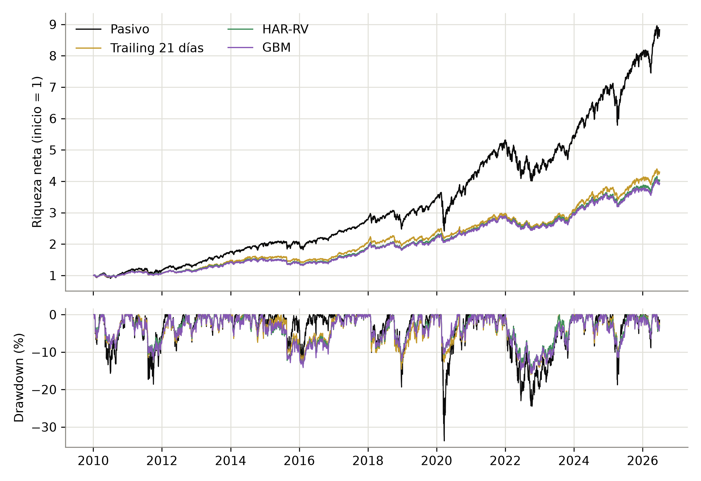

# SPY Volatility Targeting

Pronóstico de volatilidad del S&P 500 aplicado a una estrategia de volatility targeting.

**Andrés Otero y Ezequiel Telias** · Finanzas Computacionales · UCEMA · 2026

¿Una mejora en el pronóstico de volatilidad se traduce en una mejor cartera?
Comparamos EWMA, GARCH(1,1), HAR-RV y gradient boosting con LightGBM,
y usamos sus pronósticos para determinar la exposición de una cartera de SPY
y efectivo. Incluimos una variante con VIX, un targeting sin modelo y SPY
comprado y mantenido como referencias.

La evaluación fuera de muestra cubre enero de 2010 a junio de 2026, con
estimación expansiva y ajustes mensuales. La estrategia tiene un objetivo de
volatilidad anual de 10%, un tope de apalancamiento de 1.5 veces, una banda de
no-trade de 5 puntos porcentuales y costos de 2 puntos básicos por operación.
El peso decidido al cierre de un día se ejecuta al cierre siguiente.

## Resultados y notebooks

El gradient boosting mejora la precisión del pronóstico, pero esa ventaja no
llega a la cartera. Ninguna estrategia muestra un alfa ni un ratio de Sharpe
distinguibles de SPY, antes o después de costos, y con los costos del caso base
el gradient boosting queda último. Las tablas y notebooks permiten recorrer la
comparación desde el error de pronóstico hasta el resultado de la cartera.

* [Tablas y gráficos](data/cache/report/): resultados numerados del trabajo.
* [Pronósticos](notebooks/check_models.ipynb): comparación de modelos.
* [Estrategias](notebooks/check_strategy_evaluation.ipynb): resultados del backtest.
* [Oráculos](notebooks/check_oracle_ceiling.ipynb): diagnóstico con información futura.



## Reproducir el trabajo

Requiere Python 3.12 o superior y [uv](https://docs.astral.sh/uv/).
Desde una terminal:

```bash
git clone https://github.com/EzeTelias95/spy-volatility-targeting.git
cd spy-volatility-targeting
uv sync --frozen
```

Los datos y resultados ya están incluidos. Para explorar las notebooks:

```bash
uv run --frozen jupyter notebook
```

Para reconstruir la base, estimar los modelos, ejecutar los backtests y generar
las tablas y gráficos desde los datos congelados:

```bash
uv run --frozen python -m evaluation.run_all
```

La corrida completa incluye la búsqueda de hiperparámetros y los tests
estadísticos. Para generar solamente el reporte desde los resultados guardados:

```bash
uv run --frozen python -m reporting
```

Para ejecutar las pruebas:

```bash
uv run --frozen pytest -q
```

## Estructura

| Carpeta | Contenido |
| --- | --- |
| `models/` | Modelos de pronóstico y benchmark de varianza trailing. |
| `backtest/` | Pesos, ejecución, costos y fondeo de la cartera. |
| `evaluation/` | Evaluación cronológica, métricas y tests estadísticos. |
| `reporting/` | Generación de tablas y gráficos. |
| `notebooks/` | Notebooks ejecutadas de análisis y verificación. |
| `tests/` | Pruebas de cálculos, alineación temporal y evaluación. |
| `data/snapshots/` | Datos crudos congelados y manifiesto de integridad. |
| `data/cache/` | Base procesada, pronósticos, estrategias y reporte. |
| `entregas/` | Propuesta y entregas previas en PDF. |

## Datos y trazabilidad

SPY y VIX provienen de Yahoo Finance, y la tasa libre de riesgo de la serie
DGS3MO de FRED. La descarga está congelada al 24 de agosto de 2026 y la muestra
termina el 30 de junio de 2026. La medida de volatilidad realizada es
Garman-Klass más overnight, con ajuste por dividendos en el salto de apertura.

Las versiones de las dependencias están fijadas en `uv.lock`. Los manifiestos
conservan la fecha, el identificador de la corrida que produjo cada resultado y
las huellas de los datos utilizados.

## Entregas en PDF

* [Propuesta de tesina](entregas/Propuesta_tesina_telias_otero_volatility_trading.pdf)
* [Entrega 2](entregas/Entrega2_VolatilityTrading_Otero_Telias.pdf)
* [Entrega 3](entregas/Entrega3_VolatilityTrading_Otero_Telias.pdf)
* [Entrega 4](entregas/Entrega4_VolatilityTrading_Otero_Telias.pdf)
